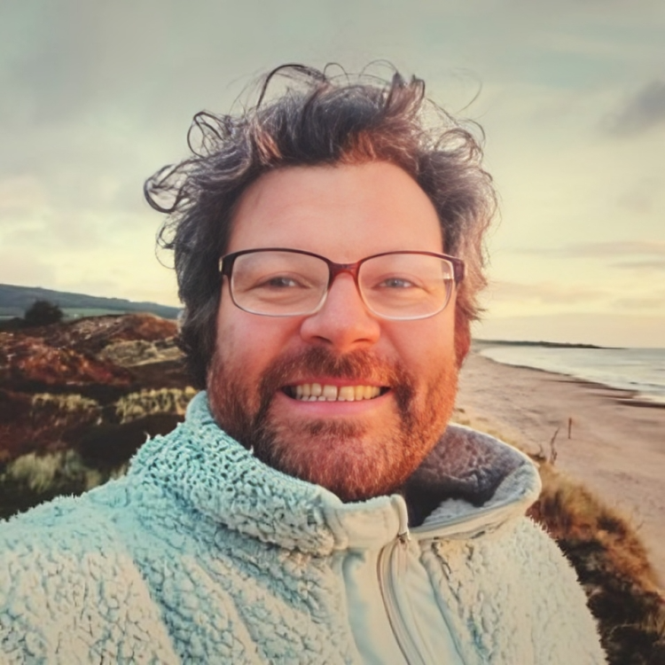

# Do you want to be better understood when speaking English?

{fig-align="center"}

*Do you want to make sure that your English can always be understood?*

*Would you like to improve your English pronunciation?*

*Do you want to build confidence in expressing yourself in English?*

------------------------------------------------------------------------

**I teach the following**

-   **English pronunciation**

-   **General English** to all levels

-   **Communication skills** for employees and graduates (e.g. presentation, interviews, etc).

**Where?**

-   Online

-   In person (please enquire)

-   Around County Wicklow, the garden county

**How?**

-   **Classes** personalised to your needs.
-   Achievable goals across a block of classes

You can also **come to County Wicklow, for** a day or a week. We will do normal classes in the morning and outdoor activities in the afternoon. We'll meet locals in the town and go hiking around the beautiful hills and coastline.

**Accommodation** can be arranged in top-rated local Airbnbs.

------------------------------------------------------------------------

[Explore the services](services.qmd){.btn .btn-primary} [Get in touch](contact.qmd){.btn .btn-outline-primary}

:::: hero-aside
::: video-container
<iframe src="https://www.youtube.com/embed/godLqIam-Og" title="Introduction to my English teaching" loading="lazy" allow="accelerometer; autoplay; clipboard-write; encrypted-media; gyroscope; picture-in-picture; web-share" referrerpolicy="strict-origin-when-cross-origin" allowfullscreen>

</iframe>
:::

A thoughtful, practical approach to spoken English.

::::

::: intro-band

English pronunciation is the forgotten part of English teaching. Many people can speak and listen, read and writer, but they struggle to be understood when they speak. That's my speciality. I can also train you to understand native speakers even if they appear to speak extra fast.\

:::

## How I can help

:::::: service-grid
::: service-card

01 / INDIVIDUALS

## Pronunciation coaching

Do you want to be understood better and sound like a native? We'll work on the sounds of English, its rhythm, and the all-important connected speech which distinguishes natives from those who learn English on paper.

[Explore pronunciation coaching](services.qmd#pronunciation)
:::

::: service-card

02 / PROFESSIONALS

## Communication at work

Build confidence in meetings, presentations, networking and the everyday conversations that matter professionally.

[Explore communication coaching](services.qmd#professional-communication)
:::

::: service-card

03 / ORGANISATIONS

## Workshops and training

Practical English communication workshops for universities, international teams and professional groups.

[Explore workshops](services.qmd#workshops)
:::
::::::

## Linguistic expertise. Practical teaching.

I bring together a background in linguistics and hands-on teaching experience. That means looking carefully at how English works, then turning that understanding into practical steps you can use.

::: pull-quote
The aim is not to erase your accent. It is to help you communicate effectively, confidently and in a way that feels like you.
:::

::: closing-cta

START A CONVERSATION

<h2>What would you like your English to help you do?</h2>

Tell me what you want to work on, and we can discuss a suitable approach.

[Get in touch](contact.qmd){.btn .btn-primary}
:::

::: :::::::::::::
:::
